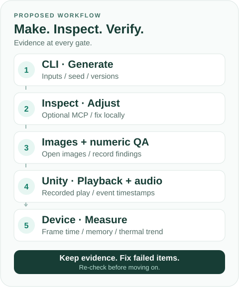

# game-production-harness

### 「生成できた」を、検証できる制作へ。

Claude Code・Blender・Unityで3Dゲームを作るための、**制作手順・合格条件・実装仕様をまとめた設計キット**です。少量のアセットから始め、見た目・動作・音・実機性能を証拠で確かめます。

> **現在は設計段階です。** 実行できるCLI・生成スクリプト・自動テストはまだありません。Blender／Unity連携、音同期、Android性能も実証前です。

[はじめる](#はじめる) · [制作の流れ](#制作の流れ) · [完了の基準](#完了の基準) · [資料](#資料) · [ライセンス](#ライセンス)

## はじめる

1. **[導入ガイドを読む](docs/QUICKSTART.md)** — 環境と権限を確認し、最初の作業範囲を決める。
2. **[合格条件を決める](docs/WORKFLOW.md)** — 代表アセット1個と、30〜60秒の短いプレイ区間に絞る。
3. **[準備指示を渡す](prompts/PREFLIGHT.md)** — バックアップと接続確認から始める。夜間運転はその後。

最初の適用対象はAndroid先行のペンギン滑走ゲーム。ゲーム本体やアセットは、この設計キットに含みません。接続ツールも導入済みではなく、[候補ごとに対応版・権限・安全性を確認](docs/SOURCES.md)します。

## 制作の流れ

**CLIで生成 → 観察・局所修正（MCPは任意） → 画像＋数値で点検 → Unityで表示・音を確認 → 実機で計測。** 図はこれから実装する工程であり、実行結果ではありません。

- **CLI：繰り返しを再現可能に。** 入力、seed、版、コマンドを保存する。
- **観察・修正：必要ならMCPを使う。** 大量の処理を会話だけで管理しない。
- **レビュー：証拠を開いて判断する。** 画像の保存だけで「見た」と扱わない。
- **編集：同じファイルは一人で。** 同一Scene／.blendへの同時書き込みを避ける。

## 完了の基準

コンパイルだけで完了にはしません。各項目を別々に確認します。

- **見た目** — 固定カメラの比較画像と、実際に見た指摘・判断
- **動作と音** — Unity内の音入り実プレイ録画とイベント時刻ログ
- **実機性能** — Android端末でのフレーム時間・メモリ・発熱傾向
- **再現性** — 日時、コミット、環境、実行ログ、最後の検証済み地点

未実施は「未確認」、進めない項目は「ブロック」。失敗した箇所だけ直し、証拠を取り直します。**Pixel 8で60fpsは暫定目標であり、達成値ではありません。**

## 資料

- [制作手順と合格条件](docs/WORKFLOW.md) — 環境確認から朝のレビューまで
- [ハーネス実装仕様](docs/HARNESS_SPEC.md) — 状態、証拠、排他編集、段階的な実装順
- [参考資料と採用理由](docs/SOURCES.md) — 制作事例・技術記事と、それぞれの限界
- [夜間作業の指示](prompts/OVERNIGHT.md) — 承認済みの範囲、停止条件、報告
- [公開前レビュー結果](docs/REVIEW.md) — 修正点と、まだ検証していないこと
- [公開前チェック](docs/PUBLISH_CHECKLIST.md) — 秘密情報、権利、実証範囲を確認
- [Claude Codeへの入口](CLAUDE.md) — 必要な文書だけを読むための案内

## ライセンス

本リポジトリの**独自文書・独自図はCC BY 4.0**です（[ライセンス](LICENSE.md)／[日本語の概要](https://creativecommons.org/licenses/by/4.0/deed.ja)）。再利用時は出典、ライセンスへのリンク、変更の有無を示してください。

第三者の記事・画像・コード・音源・モデルには適用されません。実行可能なプログラムは未提供であり、将来のコードのライセンスは別途決めます。

更新：2026-10-15 · 実行結果は、日時・コミット・環境・証拠とともに追記予定。
